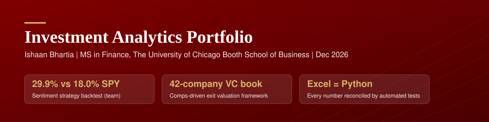

<p align="center">
  
</p>

<p align="center">
  
  
  
  
</p>

## Executive summary

Two investment problems, each taken from a judgment call to a model that a reviewer can audit, re-run and reconcile.

- **Earnings call sentiment.** I turned earnings call transcripts into comparable, rubric-anchored scores across six dimensions, and built the scorecard that tracks how management and analyst tone shift quarter to quarter. In a Chicago Booth competition, our team's sentiment-ranked portfolio returned **29.94% against 18.01% for SPY** (Sharpe 1.77).
- **Venture exit valuation.** At Cedars-Sinai Technology Ventures I replaced a hardcoded exit multiple with a **comparables-driven, probability-weighted** exit value for a 42-company venture portfolio, adding ownership-adjusted MOIC, PV and follow-on reserves. It is shown here on synthetic data.
- **Controls.** Both workbooks are formula-driven, a Python implementation reproduces them to the cent, and 11 automated tests fail if anything drifts.

## Featured work

<table>
<tr>
<td width="50%" valign="top">

### [Earnings Call Sentiment Analyzer](earnings-call-sentiment/)

**Question.** Can the tone of an earnings call be measured consistently enough to compare companies and track change?

**Approach.** Six scored dimensions (management tone, guidance, risk language, analyst sentiment, financial health, strategic clarity), a written rubric, user-set weights, and a validation pipeline.

**Insight.** The gap between upbeat management and skeptical analysts (McDonald's, Pfizer, Caterpillar) is the signal a single score hides.

<a href="earnings-call-sentiment/"></a>

</td>
<td width="50%" valign="top">

### [Venture Portfolio Exit Valuation](vc-exit-valuation/)

**Question.** What is a hospital venture portfolio worth at exit once failure risk, dilution and follow-on capital are priced in?

**Approach.** Exit value from median M&A/IPO comps and stepped-up private peers; P(exit), timing and reserves driven by company stage only, never by the hospital relationship.

**Insight.** A flat multiple overstates value about 2x; funding pro-rata follow-ons roughly halves net MOIC.

<a href="vc-exit-valuation/"></a>

</td>
</tr>
</table>

## What this demonstrates

| Capability | Where to look |
|---|---|
| Valuation: comps, probability weighting, PV, MOIC, reserves | [`vc-exit-valuation/README.md`](vc-exit-valuation/README.md), [workbook](vc-exit-valuation/workbook/) |
| Turning qualitative information into investable data | [scoring rubric](earnings-call-sentiment/analyzer/references/scoring-rubric.md), [scored dataset](earnings-call-sentiment/data/scores.csv) |
| Data quality and reconciliation | [corrections log](earnings-call-sentiment/data/data_corrections.csv), [tie-out tests](tests/test_portfolio.py) |
| Scenario thinking | [MOIC sensitivity grid](vc-exit-valuation/outputs/moic_sensitivity.png), custom weights in the scorecard |
| Handling confidential data | synthetic generator plus a test that blocks real identifiers |

## Repository map

```
earnings-call-sentiment/   analyzer (Claude plugin + rubric), data, Python pipeline, charts, workbook
vc-exit-valuation/         synthetic portfolio and comps, valuation engine, sensitivity, charts, workbook
tests/                     Excel vs Python tie-outs, data validation, confidentiality guard
```

## Run it

```bash
git clone https://github.com/ibhartia/investment-analytics-portfolio.git
cd investment-analytics-portfolio
pip install -r requirements.txt

python earnings-call-sentiment/src/scorecard.py
python vc-exit-valuation/src/exit_valuation.py
pytest -q
```

## About me

MS in Finance candidate at **The University of Chicago Booth School of Business** (December 2026). B.Sc. in Economics, Mathematics and Statistics, St. Xavier's College, Mumbai.

Experience across the investment cycle: venture portfolio valuation at **Cedars-Sinai Technology Ventures**, sell-side IPO execution for a power distribution EPC company, equity research at **Anand Rathi**, and financial due diligence at **KPMG India**.

**Contact:** [ishaanbhartia@gmail.com](mailto:ishaanbhartia@gmail.com)
