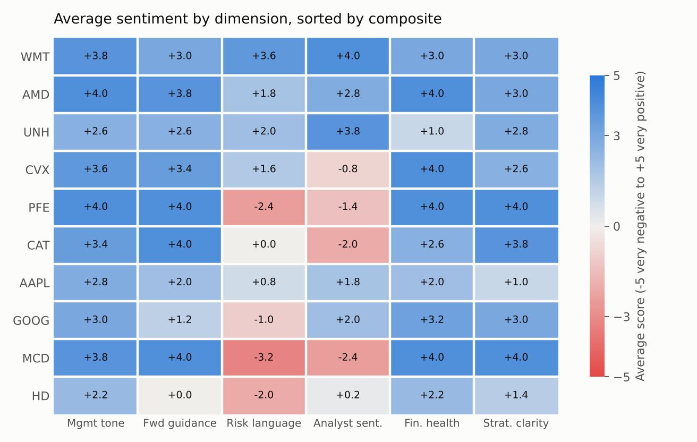
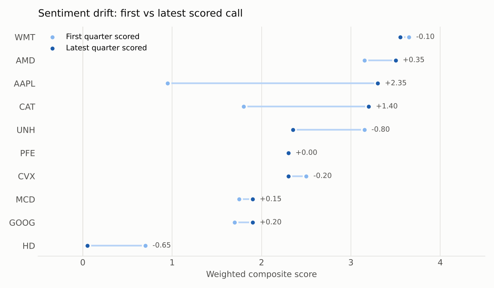

# Earnings Call Sentiment Analyzer

A structured, repeatable way to turn earnings call transcripts into comparable sentiment scores, and a scorecard that tracks how management and analyst tone moves quarter to quarter.

I built a scoring engine: a Claude-based analyzer with an explicit rubric, a weighted composite, and an Excel scorecard that keeps every call auditable. This folder contains the analyzer, the scored dataset, a Python pipeline that rebuilds and validates the scorecard, and the workbook.

## How it works

Each transcript is scored from **-5 (very negative) to +5 (very positive)** on six dimensions, each anchored to a written rubric ([`analyzer/references/scoring-rubric.md`](analyzer/references/scoring-rubric.md)) so two analysts scoring the same call land in the same place:

| Dimension | What it measures | Weight |
|---|---|---|
| Management tone | Confidence, ownership and energy of delivery | 20% |
| Forward guidance | Strength, specificity and direction of outlook | 25% |
| Risk language | Frequency and severity of hedging and risk vocabulary | 15% |
| Analyst sentiment | Supportive vs. skeptical vs. adversarial Q&A | 20% |
| Financial health | Language around revenue, margins, cash flow, balance sheet | 10% |
| Strategic clarity | Coherence and consistency of the strategy narrative | 10% |

The composite is the weighted average, rounded to two decimals. Weights are user-editable (in the workbook or via `--weights`), and every scored call carries a one-line bullish and bearish signal so the number can be traced back to the transcript.

```
analyzer/      Claude plugin: skill instructions, scoring rubric, manifest
data/          scores.csv (49 calls, 10 companies), weights.csv, data_corrections.csv
src/           scorecard.py: validation, composite, company summary, charts
outputs/       scored_transcripts.csv, company_summary.csv, charts
workbook/      Earnings_Sentiment_Scorecard.xlsx (formula-driven, editable weights)
```

## Sample scorecard: 10 large caps, Q4 2024 to Q4 2025





| Ticker | Calls | Avg composite | Latest | Change (latest vs first) |
|---|---|---|---|---|
| WMT | 5 | 3.45 | 3.55 | -0.10 |
| AMD | 5 | 3.28 | 3.50 | +0.35 |
| UNH | 5 | 2.61 | 2.35 | -0.80 |
| CVX | 5 | 2.31 | 2.30 | -0.20 |
| PFE | 5 | 1.96 | 2.30 | 0.00 |
| CAT | 5 | 1.92 | 3.20 | +1.40 |
| AAPL | 5 | 1.84 | 3.30 | +2.35 |
| GOOG | 4 | 1.79 | 1.90 | +0.20 |
| MCD | 5 | 1.60 | 1.90 | +0.15 |
| HD | 5 | 0.54 | 0.05 | -0.65 |

**What the dimensions reveal that a single score would hide.** McDonald's, Pfizer and Caterpillar all score +3.4 to +4.0 on management tone and guidance, yet their analyst sentiment is negative (-1.4 to -2.4) and risk language neutral to clearly negative. Management is upbeat while the sell side is pushing back, and that gap is exactly the kind of signal worth a closer look. Walmart is the opposite case: management and analysts agree, and it leads the sample on consistency. Home Depot is the weakest and still deteriorating, with "challenging environment" language rising through 2025. Apple shows the largest improvement, from tariff-driven caution in early 2025 to record-quarter guidance by Q4.

## Running it

```bash
pip install -r ../requirements.txt
python src/scorecard.py                       # validate, score, summarise, chart
python src/scorecard.py --weights my.csv      # re-run under a different weighting
```

The pipeline checks that weights sum to 100%, every score sits in [-5, +5], call dates are valid and chronological, and no ticker/quarter is duplicated. The Python composites and company averages reconcile exactly to the workbook (see [`../tests`](../tests)).

To score a new call, install the plugin in [`analyzer/`](analyzer/) into Claude, provide the transcript, and append the resulting row to `data/scores.csv` or the workbook's All Scores tab.

## Data quality notes

Building the pipeline surfaced eight data-entry errors in the original workbook, now corrected and logged in [`data/data_corrections.csv`](data/data_corrections.csv): six call dates that were mis-keyed or impossible (e.g. 31 June 2025), and two Walmart rows labelled with the wrong fiscal year (Walmart's fiscal year ends in January). The company summary tab, previously typed in by hand, is now formula-driven so it cannot drift from the underlying scores.

## Backtest

I ran a sentiment-ranked strategy across 80 companies, holding the top 10 by score each quarter, over five quarters, with a DSPy + Llama 3.2 pipeline for batch scoring. Reported results against SPY: **29.94% total return vs. 18.01%**, Sharpe ratio **1.77**, annualized alpha of roughly **14%**, beta **0.76**. The backtest code belongs to the team and is not reproduced here; the results are included for context, and a five-quarter window is short, so they should be read as directional rather than conclusive.

## Limitations

- Scores reflect language, not reported numbers. A company can sound confident and still miss consensus, so the scorecard is a complement to financial analysis, not a substitute.
- Borderline calls involve judgment; the rubric narrows it but does not remove it. Scores are best used directionally.
- Transcripts are sourced manually, so history is only as long as the calls that have been scored.
- If a transcript has no Q&A, analyst sentiment is N/A; the Python pipeline re-normalises the remaining weights, while in the workbook the weights are adjusted manually.
