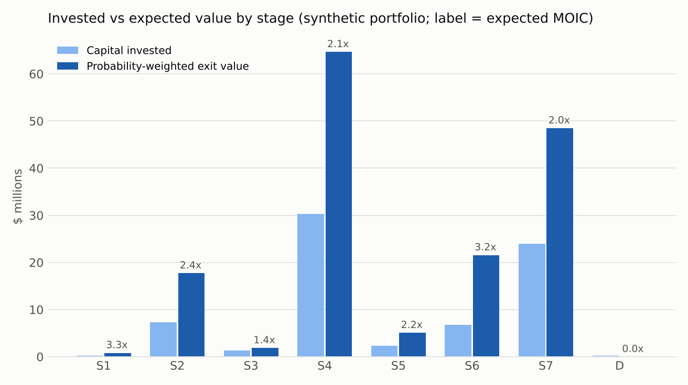
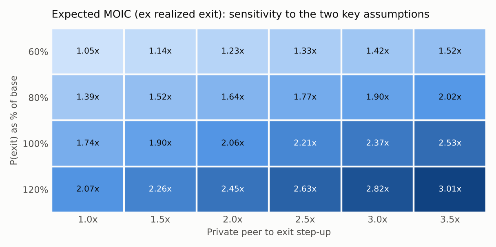

# Venture Portfolio Exit Valuation Framework

> **All company data in this folder is synthetic.** The model was built on a confidential venture portfolio during my summer 2026 role as an Accelerator+ Summer Associate at Cedars-Sinai Technology Ventures. The structure, formulas, stage ladder and methodology are the original work; every company name, valuation, ownership stake, investment amount and comparable here is randomly generated (seeded and reproducible via [`src/make_synthetic_data.py`](src/make_synthetic_data.py)).

## The problem

The team's portfolio model valued each company's eventual exit as a **hardcoded multiple of its current valuation**. That single number flowed into the fund's exit value and IRR reporting. Two issues followed:

1. A flat multiple ignores what the market actually pays for comparable companies, so a preclinical biotech and a revenue-generating SaaS business were grown at the same rate.
2. Probability-of-success assumptions were tied to the company's **deployment status inside the hospital** (pilot, deployed, not engaged). That reflects the hospital's relationship with the company, not the company's market maturity, and it was skewing the outputs.

## The approach

I rebuilt exit value bottom-up from comparables for a 42-company portfolio, and made **external company stage** the only driver of probability, timing and reserves.

**Exit value per company** comes from two independent comp sets, shown side by side:

- **Exit comps** (M&A and IPOs of similar companies) are already exit values; the estimate is their **median**.
- **Private comps** (recent private rounds of peers) are current values; the estimate is their **mean x a step-up** to exit (2.5x by default, 1.0x where peers already trade at exit-scale valuations).
- The model uses the average of the two, or whichever exists. Each comp carries an include/exclude flag and a written reason (stage-matched, modality, geography, staleness), so every exit value is auditable back to its comp set.

**Expected value to the fund**

```
Expected value = P(exit) x Exit value x Fully diluted ownership
PV             = Expected value / (1 + 15%) ^ (exit year - 2026)
Expected MOIC  = Expected value / Capital invested
```

**Stage ladder** (drives probability, timing and follow-on reserves only, never the exit value):

| Code | Stage | Default P(exit) | Years to exit | Reserve ratio |
|---|---|---|---|---|
| S1 | Discovery / Concept | 8% | 9 | 2.5x |
| S2 | R&D / Preclinical | 13% | 7 | 2.0x |
| S3 | Prototype / Early Pilot | 20% | 6 | 1.5x |
| S4 | Clinical / Field Validation | 30% | 5 | 1.5x |
| S5 | Late-Stage / Pivotal | 45% | 4 | 1.0x |
| S6 | Regulatory / Pre-Commercial | 62% | 3 | 0.75x |
| S7 | Commercial / Revenue | 72% | 2 | 0.5x |
| D | Disengaged / Distressed | 3% | 1 | 0 |
| X | Realized / Exited | 100% | 0 | 0 |

Company-specific evidence (for example a PitchBook exit-predictor probability) goes in a separate **override** column, so the stage default and the judgment call are both visible.

**Model 2** adds follow-on reserves: the capital needed to hold pro-rata ownership through later rounds, sized by stage. Holding ownership constant at exit is only realistic if that capital is spent, so the net MOIC on total capital deployed is the more honest portfolio number.

## Results on the synthetic portfolio

| Metric | Value |
|---|---|
| Capital invested | $80.0m |
| Gross exit value to fund | $378.7m |
| Probability-weighted (expected) value | $191.7m |
| PV of expected value at 15% | $122.7m |
| Expected MOIC, all companies | 2.40x |
| Expected MOIC, excluding the realized exit | 2.21x |
| Follow-on reserves to hold pro-rata | $82.0m |
| Net expected MOIC on total capital deployed | 1.18x |
| Legacy method (current value x 3.0x), for comparison | $425.4m |





Three things the framework makes visible that the legacy multiple could not:

- **The legacy method overstates value** because it applies no probability of failure. On this portfolio it implies $425m against $192m probability-weighted.
- **A single realized exit can dominate the portfolio MOIC.** The summary reports MOIC with and without realized positions so the unrealized book is judged on its own.
- **Reserves matter as much as exits.** Funding pro-rata follow-ons roughly halves the net multiple, which is the right input for planning future capital calls.

The sensitivity grid shows the two assumptions to argue about in committee: the private-peer step-up and the level of exit probabilities. Each 0.5x change in the step-up moves expected MOIC by about 0.16x; a 20% shift in exit probabilities moves it by about 0.4x, so probability calibration is the bigger lever.

## Files

```
data/       portfolio.csv, comps.csv (synthetic), stage_ladder.csv, assumptions.csv
src/        exit_valuation.py   Python implementation of the workbook, plus sensitivity and charts
            make_synthetic_data.py   regenerates the synthetic inputs
workbook/   Exit_Valuation_Framework_SAMPLE.xlsx   Methodology, Summary, Valuation Model,
            Valuation Model 2 (reserves), Assumptions, Comps
outputs/    valuation_output.csv, moic_sensitivity.csv, charts
```

```bash
pip install -r ../requirements.txt
python src/exit_valuation.py                 # base case, sensitivity, charts
python src/exit_valuation.py --stepup 2.0    # re-run with a different global step-up
```

## Controls

- Every probability in the model is formula-driven (`override if present, else stage default`), so no value can be typed over silently.
- The Python engine reproduces the workbook cell for cell; [`../tests`](../tests) checks every company's exit value, expected value, PV and MOIC against the recalculated Excel file, plus the portfolio totals.
- Inputs are blue, links to the assumptions sheet green, calculations black, and each comp's inclusion decision is recorded with a reason.
